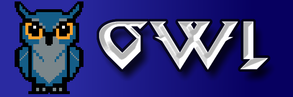
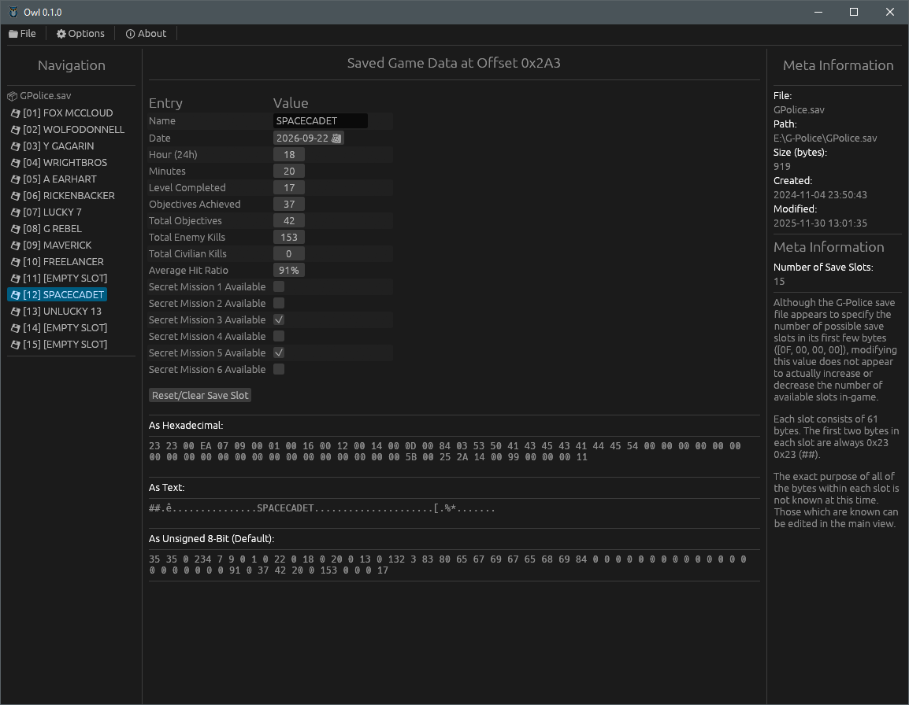
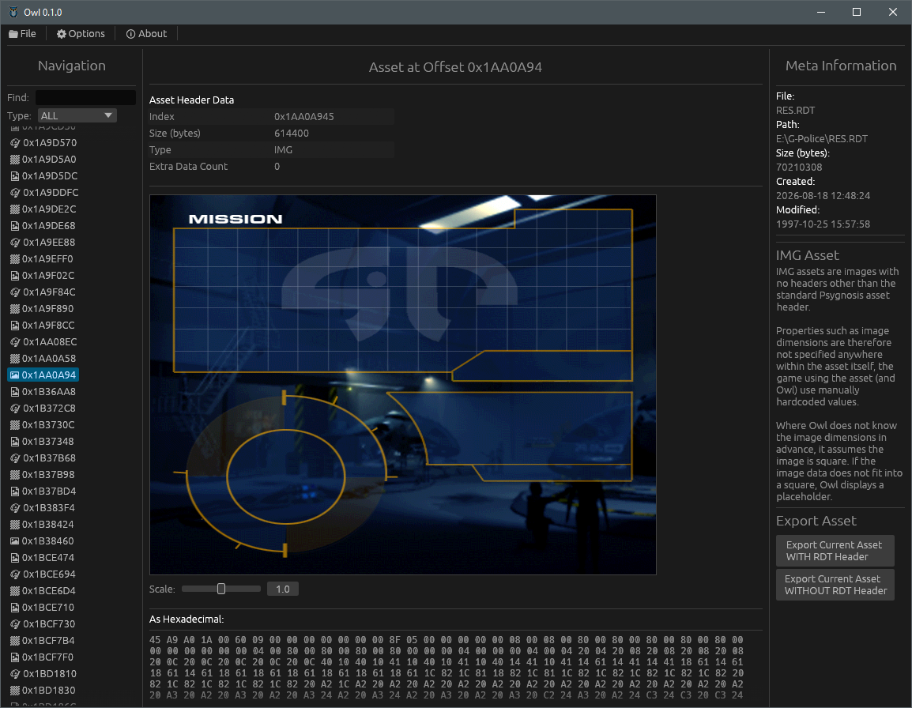
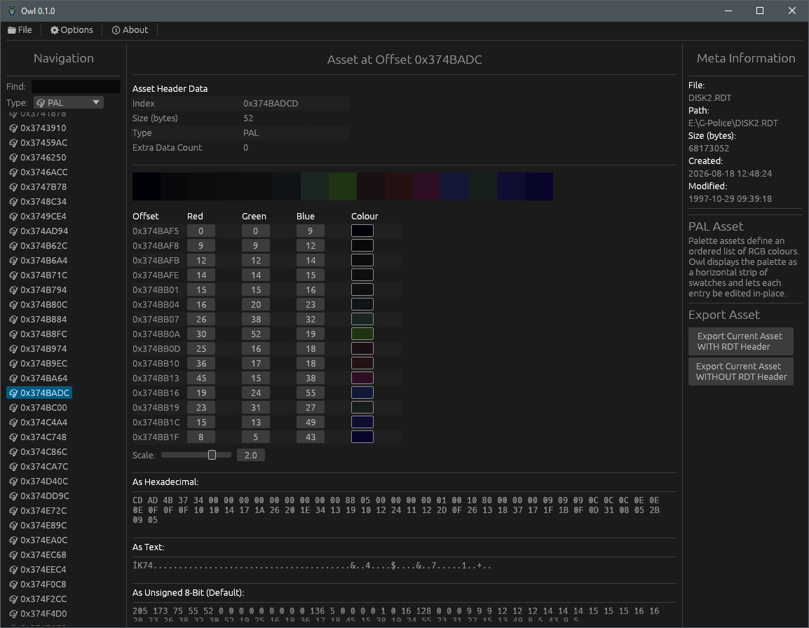
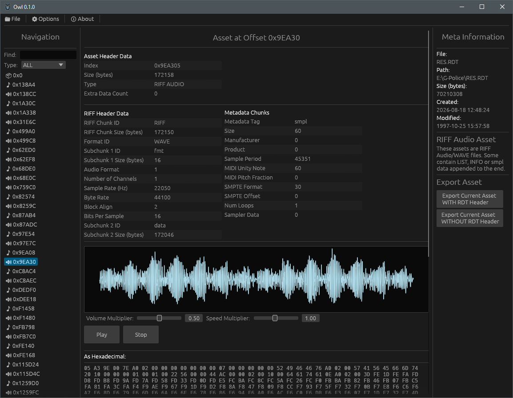

  <div align="center">
    
  </div>

---

# Owl
Owl is a tool for viewing, extracting and editing Psygnosis game data files.

Owl is potentially a useful companion project/tool to [Hangar](https://github.com/DASA-KAMOV/Hangar/), as it could in principle be used to help idenfity/edit/extract assets for use with it's asset override feature.

Contributions from the community to extend, optimize or improve Owl are welcome.

## Contents

* [Owl](#owl)
* [Supported Formats](#supported-formats)
* [Known Issues](#known-issues)
* [Building from Source](#building-from-source)
* [The AI Ramble](#the-ai-ramble)
* [License](#license)
* [Screenshots](#screenshots)

---

## Supported Formats
| Game | Platform | Description | Extension | Support |
| :-- | :------: | :---------: | :-------: | :-----: |
| G-Police | Windows | Saved Game Data | .SAV | Gold |
| G-Police | Windows | Resource Data Table | .RDT | Silver |
| G-Police | PSX | Resource Data Table | .RDT | Bronze |
| G-Police: Weapons of Justice | PSX | Resource Data Table | .RDT | Bronze |
| Tellurian Defense | Windows | Resource Data Table | .RDT | Bronze |
| Overboard! / Shipwreckers | PC | Resource Data Table | .RDT | Bronze |
| Asssult Rigs | Windows/DOS | Resource Data Table | .RDT | Bronze |

Key:
* **Platinum:** Full Support for all major features such as viewing, editing and extracting all relevant data (as applicable).
* **Gold:** Functional support for viewing, editing, extracting all relevant data (as applicable), but some features may be limited.
* **Silver:** Partial support. Some major features may be limited or unavailable.
* **Bronze:** Limited support. All major features are either limited or unavailable.

---

## Known Issues

* **Antivirus Software Identifies Owl as Malware**
  * Add Owl to your antivirus software's exceptions list.
    * It is not clear what causes this. I distribute Owl pre-compiled for user convenience. What you gain in convenience, you give in trust. If you do not trust the compiled binary, then I strongly encourage you to download and review the source code. Once you are satisfied that no unwanted behaviour is occurring, you can build it from the source code yourself.

* **No Icon on Linux**
  * To get Owl using it's icon correctly, place an owl.desktop file into `~/.local/share/applications/`:

    ```ini
    [Desktop Entry]
    Version=1.0
    Type=Application
    Name=Owl
    Comment=A tool for viewing, extracting and editing and Psygnosis game data files.
    Path=
    Exec=
    Icon=
    Terminal=false
    Categories=Utilities
      ```

    With `Path=`, `Exec=` and `Icon=` set. See [here](https://wiki.archlinux.org/title/Desktop_entries) for .desktop file specifications.

* **Empty UI when running on a Windows Virtual Machine (Linux Host)**
  * The VM is likley using Mesa3D software/virtualised OpenGL/Vulkan drivers (such as llvmpipe, lavapipe, or VirtIO/SVGA) rather than a native hardware GPU driver. Try forcing the use of the DirectX 12 / WARP software rasteriser instead by running Owl through the powershell command line eg.
    ```ps1
    $env:WGPU_BACKEND="dx12"
    .\owl.exe
    ```
---

## Building from Source
I only build for x64 Windows and x64 Linux. Owl may build to other targets, but this is untested.

### Prerequisites

* Rust toolchain (`rustup` and `cargo`) installed.
* If cross-compiling, install host toolchains for cross-compilation. The specifics of this are beyond the scope of this Readme, but, for example:
  * **Windows Host**: Have Windows SDK / Visual Studio Build Tools installed. Use Windows Subsystem for Linux (WSL2) or the `cross` crate with Docker for Linux targets.
  * **Linux Host:** Use MinGW-w64 (`x86_64-w64-mingw32-gcc` and `ar`) for Windows targets.

### Compiling
If cross-compilation isn't a concern for you, you can just use `cargo` to build natively:
```bash
# Omit the --release flag if you intend on debugging.
cargo build --release
```

### Cross-Compiling

#### Install Rust Targets

Add the desired targets to `.cargo/config.toml`. Eg.
```toml
# 64-bit Windows GNU Target
[target.x86_64-pc-windows-gnu]
linker = "x86_64-w64-mingw32-gcc"
ar = "x86_64-w64-mingw32-ar"

# 64-bit Linux GLIBC Target
[target.x86_64-unknown-linux-gnu]
```
Add the desired targets using `rustup`. Eg.
```bash
rustup target add x86_64-pc-windows-gnu
rustup target add x86_64-unknown-linux-gnu
```
#### Build
Use `cargo` to build. Eg.
```bash
# Omit the --release flag if you intend on debugging.
cargo build --release --target x86_64-pc-windows-gnu
cargo build --release --target x86_64-unknown-linux-gnu
```

---

## The AI Ramble
**TL;DR:** No AI was used in this project.

I release this at an interesting time for reverse engineering and modding.

[AI decomp/recomp tools](https://github.com/teonett/Reverse-Engineer-Anything) are currently making waves in modding/reversing communities. Whether this is for better or worse remains to be seen. In the meantime, every new project that appears is being judged on whether AI had any part in its creation, for fear of it being low-quality vibe-coded slop.

Rest assured, all code I have written for this project is lovely, wholesome, human-coded slop.

My rationale for this is less to do with AI itself, and more to do with my goals. This project was a way to teach myself Rust, and it is (mostly) succeeding in that goal - needless to say, I would have learned very little if I simply had an LLM do the work for me.

If future contributors to this project want use AI to assist them, I am not in principle opposed to it. All I ask is that anyone doing so uses it as a tool, not as a replacement for their brain. Read and understand the code you are submitting, and participate meaningfully in the art of creation.

---

## License
Owl is free software.

You may redistribute it and/or modify it under the terms of the [GNU General Public License, Version 3](https://www.gnu.org/licenses/gpl-3.0.en.html) as published by the Free Software Foundation, or (at your option) any later version.

Owl is distributed in the hope that it will be useful, but WITHOUT ANY WARRANTY; without even the implied warranty of MERCHANTABILITY or FITNESS FOR A PARTICULAR PURPOSE.

---

## Screenshots

<a href="./images/OwlSaveEditor.png">
  
</a>
<a href="./images/OwlIMG.png">
  
</a>
<a href="./images/OwlPAL.png">
  
</a>
<a href="./images/OwlRIFF.png">
  
</a>

---